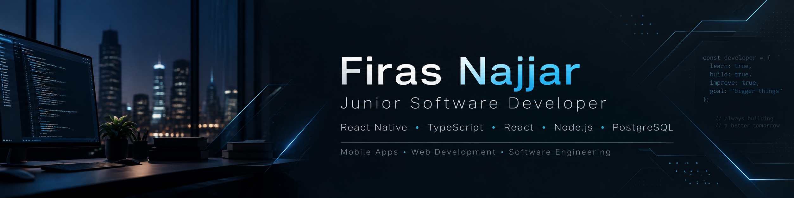

<!-- GitHub profile README for github.com/firas988 -->
<!-- Place this file in the root of the public firas988/firas988 repository. -->

  

  
   
  
  
  

 

## 👋 About Me

I'm **Firas Najjar**, a **Software Engineering graduate (2026)** who enjoys taking ideas from concept to working software. I build across **mobile development, full-stack web applications, backend systems, and games** — with a focus on clean functionality and thoughtful user experiences.

- 🚀 **Shipped a real app:** [Arcadia Care](https://apps.apple.com/il/app/arcadia-care/id6803895935), published on the Apple App Store.
- 🛠️ **Currently building:** **Naitru**, a platform for digital services and software project workflows.
- 🧠 **Currently learning:** AI agents, applied AI, and the foundations of building AI systems.
- 🎓 **Education:** Software Engineering, **בית הספר להנדסאים בקריית הטכניון** — class of **2026**.
- 🔍 **Additional foundation:** Quality Assurance (QA), data communications, and computer networking.
- 🤝 **Open to:** Junior Software Developer, Full-Stack Developer, and Mobile Developer opportunities.

## 🚀 Featured Projects

### 📱 [Arcadia Care](https://apps.apple.com/il/app/arcadia-care/id6803895935) — Published Mobile Application

A cross-platform app for a computer service business, making it easier for customers to request technical services and follow the progress of their repairs.

- Customer service requests and repair-status tracking
- Device pickup coordination and location sharing
- Account management, customer support, and backend API integration
- Developed for mobile with an emphasis on a polished and intuitive UI

**Stack:** `React Native` · `Expo` · `TypeScript` · `Node.js` · `REST APIs`

### 🎮 [Lost City](https://github.com/firas988/Lost_City_Project) — 3D Adventure / RPG Project

An exploration-focused Unity game set in a mysterious city, featuring interactive environments and gameplay systems.

- Character interactions, quests, and exploration
- Inventory, equipment, and gameplay mechanics
- Environmental design, effects, and performance optimization

**Stack:** `Unity` · `C#` · `Game Development`

### 📒 [PhoneBook](https://github.com/firas988/Node_Project_PhoneBook) — Full-Stack Practice Project

A contact-management application featuring a RESTful CRUD API and a relational database.

**Stack:** `Node.js` · `Express.js` · `MySQL` · `REST APIs`

## 🛠️ Tech Stack & Technologies

### 💻 Programming Languages

  

### 🎨 Frontend Development

  

### 📱 Mobile Development

  
   
  React Native

### ⚙️ Backend Development

  

### 🗄️ Databases & ORM

  

  SQL · Relational Database Design · Database Management

### ☁️ Cloud & DevOps

  

### 🔧 Development Tools

  

## 📈 GitHub Activity

  
<b>Show GitHub statistics</b>

   
  

    
  

  
Stats are generated by an external service and may occasionally be unavailable.

## 🌐 Let's Connect

I'm interested in opportunities to collaborate, learn, and build useful products.

- **LinkedIn:** [linkedin.com/in/firas-najjar](https://www.linkedin.com/in/firas-najjar/)
- **Email:** [firasngr@gmail.com](mailto:firasngr@gmail.com)
- **Projects:** [Explore my public repositories](https://github.com/firas988?tab=repositories)

<i>Build thoughtfully. Learn continuously. Improve with every project.</i>

